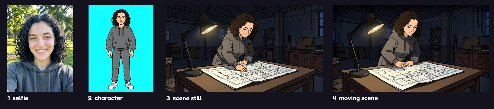

# Crew Cut

**A party game that makes a movie.** Everyone joins from their phone, turns their selfie into a character, and takes turns secretly directing scenes. Then the TV premieres a short film starring the whole crew, everyone votes on the awards, and you download the movie to post.

Built for Comfy's **#OpenSourceHiggsfield** challenge. Every frame comes out of ComfyUI through the official Comfy SDK, on open-weights models, running on a MacBook. Crew Cut by [GiveMePrompts](https://givemeprompts.com).



**Demo video (79 s, a real game on a MacBook):** https://github.com/GiveMePrompts/crew-cut/releases/download/v0.3.0/crew-cut-demo.mp4

**A finished film from that game:** [`examples/film/the-rosa-job.mp4`](examples/film/the-rosa-job.mp4) (widescreen) and [`the-rosa-job-vertical.mp4`](examples/film/the-rosa-job-vertical.mp4) (9:16 for stories). Rosa's character and every still and shot in it came out of ComfyUI on an M2 Max; Dre and Mika are two of the four Crew Cut originals.

## How a game goes
1. **TV:** open Crew Cut on a laptop hooked to the TV. Pick a genre (Heist, Horror, Rom-com) and the director's clock.
2. **Phones:** scan the QR code. Type your name, take a selfie, and Crew Cut draws you as a character. Redraw twice, or play as one of the four Crew Cut originals.
3. **Shoot:** three scenes. Each one, a different player secretly picks the shot, casts it, and adds a twist. Scenes render while the next player directs.
4. **Premiere:** title card, the three scenes with twist reveals, the end card. Phones throw emoji and ink at the screen.
5. **Awards:** vote best director and best performance. Download the film (9:16 for stories, 16:9 widescreen) or share it straight from your phone.

## The AI pipeline
Three ComfyUI workflows, all in [`workflows/`](workflows/):

| Stage | Workflow | Model | Time on an M2 Max |
|---|---|---|---|
| Selfie → character | `character.json` | FLUX.2 [klein] 4B (image edit), GGUF Q4_K_M | ~1.5 min |
| Characters → scene still | `keyframe.json` | FLUX.2 [klein] 4B with the cast as references | ~1.5 min |
| Still → moving scene | `scene.json` | LTX-Video 2B 0.9.6 distilled, GGUF Q5_K_M | ~1.5 min |

The game never sits and waits on the GPU: characters draw while people are still joining, and each scene renders while the next player directs. In the recorded demo game (3 players, 3 scenes) the character took 100 s and all three scenes were rendered 9 minutes after the last director locked in; the premiere starts the moment the last scene lands. Example outputs are in [`examples/`](examples/).

## Quick start (preview mode, no GPU)
Needs Node 18+ and an ffmpeg build with the `drawtext` filter for the film export (`brew install ffmpeg-full`; the plain `ffmpeg` formula lacks it). Point `FFMPEG_PATH` at a specific binary if needed.
```bash
npm start
```
- TV: open http://localhost:3000
- Phones: same Wi-Fi, scan the QR code on the TV.

Preview mode stylizes selfies and composites the characters into placeholder scenes so the whole game is playable without a GPU.

## Real AI on your own machine
Full setup, model downloads and Mac notes are in [workflows/README.md](workflows/README.md). Short version:
```bash
# 1. ComfyUI running with the ComfyUI-GGUF custom node and the models listed in workflows/README.md
pip install comfy-api-proxy
comfy-api-proxy run --comfyui http://127.0.0.1:8188     # serves the Comfy v2 API on :8189
# 2. Crew Cut
npm install            # Node 22+ (installs @comfyorg/sdk)
npm run comfy
```
The same code runs against Comfy Cloud or a Comfy API deployment by changing `COMFY_BASE_URL` and `COMFY_API_KEY`.

## Settings
| Env | Default | What |
|---|---|---|
| `PORT` | 3000 | Server port |
| `GENERATOR` | `mock` | `mock` (preview) or `comfy` (real AI) |
| `COMFY_BASE_URL` | Comfy Cloud | e.g. `http://127.0.0.1:8189` for local ComfyUI via comfy-api-proxy |
| `COMFY_API_KEY` | – | Needed for Comfy Cloud or a deployment |
| `MOCK_DELAY_MS` | 5000 | Fake render time in preview mode |
| `FFMPEG_PATH` | `ffmpeg` | ffmpeg binary to use (needs `drawtext`) |
| `VOTE_SECONDS` | 40 | Voting time |

Add `?ink=0` to any URL to turn off the live ink background on slow devices.

## Tests
```bash
npm start &
npm run sim                     # 4 fake phones play a full game: consent, presets, rerolls, turn order, secrecy, voting, export
node test/safety.test.js        # name and twist filter
GENERATOR=comfy PORT=3320 npm start &       # with ComfyUI + comfy-api-proxy running
node test/comfy-smoke.js http://localhost:3320   # one real selfie -> character -> scene through the Comfy SDK
```

## Privacy and safety
- Selfies are only used after the player ticks "This is me". Anyone can play as a preset instead.
- Selfies, characters and movies stay on the machine running the server (`data/`), and rooms are deleted after 6 hours.
- Names and twists go through a word filter (`generators/safety.js`), and every generation prompt asks for a family-friendly result with no real brands or logos.
- The selfie in `examples/` is AI-generated, not a real person. The four Crew Cut originals are original illustrations.

## Credits and licenses
Crew Cut's code is MIT licensed. The models are not part of this repo and keep their own licenses:
- [FLUX.2 [klein] 4B](https://huggingface.co/black-forest-labs/FLUX.2-klein-4B) and the FLUX.2 VAE by Black Forest Labs, Apache 2.0. GGUF quant by [unsloth](https://huggingface.co/unsloth/FLUX.2-klein-4B-GGUF).
- Qwen3 4B text encoder (Apache 2.0), packaged by [Comfy-Org](https://huggingface.co/Comfy-Org/z_image_turbo).
- [LTX-Video](https://huggingface.co/Lightricks/LTX-Video) by Lightricks, under the LTXV Open Weights License. GGUF quant by [city96](https://huggingface.co/city96/LTX-Video-0.9.6-distilled-gguf).
- T5 v1.1 XXL encoder (Apache 2.0), GGUF by [city96](https://huggingface.co/city96/t5-v1_1-xxl-encoder-gguf).
- [ComfyUI](https://github.com/comfyanonymous/ComfyUI), [ComfyUI-GGUF](https://github.com/city96/ComfyUI-GGUF), the [Comfy SDK](https://www.npmjs.com/package/@comfyorg/sdk) and comfy-api-proxy.
- Fluid ink background adapted from the GiveMePrompts Lab. Fonts: Big Shoulders Stencil and Fredoka (SIL Open Font License). QR codes: qrcode-generator (MIT).
